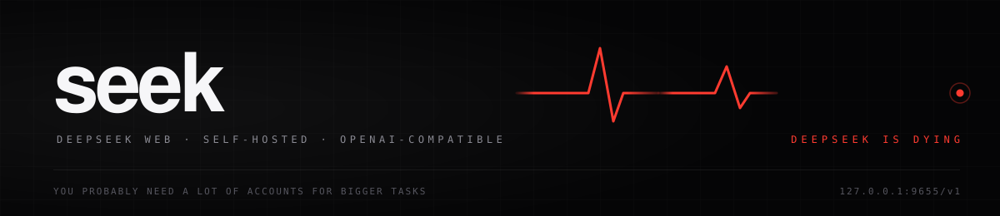

<p align="center">
  
</p>

# seek

*Made by Hyperion.*

One self-hosted gateway in front of DeepSeek web. It speaks OpenAI chat-completions, Anthropic messages and OpenAI responses, keeps **one upstream chat per conversation**, and spreads requests across a pool of logins so a throttled or dead account does not end the session.

**You probably need a lot of accounts for bigger tasks.** A DeepSeek web login serves one chat at a time and its session expires; the pool rotates, cools down and re-authenticates on its own, but the work runs out of logins long before it runs out of ideas.

## Run

```bash
git clone https://github.com/9ssault/seek.git
cd seek
npm start          # http://127.0.0.1:9655/v1  ·  dashboard at /dashboard
```

No dependencies to install: Node 22+ and its own standard library.

## Logins

`accounts/*.json` (one file per login) or one merged `deepseek-auth.json` (`auth.example.json` shows the shape). To capture one from a browser you are already signed into:

```bash
npm run deepseek:auth
npm run doctor
```

`npm run waf:refresh` refreshes the WAF tokens in place, and `GET /health` lists every login, its role and its cooldown.

## Point an agent at it

```bash
npm run setup:agents      # Claude Code, Codex, OpenCode, Hermes, OpenClaw
```

Any OpenAI-compatible client works: base URL `http://127.0.0.1:9655/v1`, key `local` (or `PROXY_API_KEY`), model `deepseek-v4-flash`, with `-thinking` and `-nosearch` variants.

## What it keeps straight

- One conversation, one upstream chat. A new conversation gets a new chat instead of continuing the last one.
- The persona is sent once per chat; later turns carry a one-line reminder, so the prompt budget goes to the work.
- A prompt that has to be trimmed is summarized on an idle login, and that summary is **cumulative** — the session keeps its goal and decisions, not just its newest turn.
- Memory survives restarts (`~/.freedeepseek-api/memory.json`), and a login is never given two chats at once.


## Browser extension

`chrome-extension/` captures a login from the browser you are already signed into: Google sign-in, live header capture, verification against DeepSeek before it is kept, pool status, and a duplicate check so the same login is never added twice. Load it unpacked from `chrome://extensions`, and it fills the pool one login at a time — which is the point.

## Container

Rootless Podman, no root, no capabilities, no writable root filesystem.

```bash
podman build --tag localhost/seek:local --file Containerfile .
podman secret create --replace free-deepseek-auth ./deepseek-auth.json
```

```bash
podman run --detach \
  --name seek \
  --publish 127.0.0.1:9655:9655 \
  --secret free-deepseek-auth,type=mount,target=/run/secrets/deepseek-auth.json,mode=0400 \
  --secret free-deepseek-proxy-key,type=mount,target=/run/secrets/proxy-api-key,mode=0400 \
  --read-only \
  --cap-drop=ALL \
  --security-opt=no-new-privileges \
  localhost/seek:local
```

The image refuses to start without `PROXY_API_KEY_FILE`, and `/readyz` answers `503` while no login can serve a chat.

## Docs

| | |
|---|---|
| [`docs/api.md`](docs/api.md) | Endpoints, streaming, images, tools |
| [`docs/agents.md`](docs/agents.md) | One-click setup per agent |
| [`docs/auth.md`](docs/auth.md) | Auth files, capture, rotation |
| [`docs/models.md`](docs/models.md) | Model IDs and flags |
| [`docs/integration.md`](docs/integration.md) | The contract to build against: endpoints, errors, sessions |

## License

Apache 2.0. Not affiliated with DeepSeek; it speaks to the public web app with your own account.
